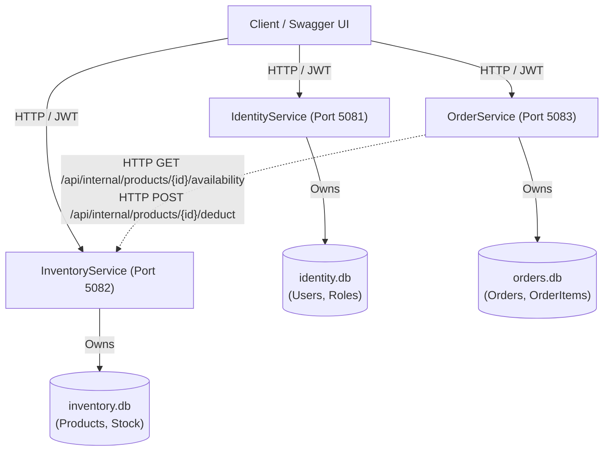

# Order Management System — .NET Microservices Architecture

An interview-ready, production-grade distributed **Order Management System** built with **ASP.NET Core (.NET 9)**, **Entity Framework Core**, **SQLite**, and **JWT Bearer Authentication**.

Designed for senior-level architectural clarity, independent service deployability, and local development safety without requiring Docker or external database servers.

---

## 1. System Architecture

The ecosystem consists of three decoupled microservices and a host gateway, each maintaining **strict database ownership** (Database-per-Service pattern). Services never query or mutate each other's databases directly; all cross-service communication occurs via validated REST APIs using `IHttpClientFactory`.



### Microservice Roles & Responsibilities

| Service | Port | Database | Primary Responsibility |
| :--- | :--- | :--- | :--- |
| **IdentityService** | `5081` | `identity.db` | User registration, authentication, PBKDF2 password hashing, and signed JWT issuance with role claims (`Admin`, `Customer`). |
| **InventoryService** | `5082` | `inventory.db` | Product catalog CRUD, pagination, stock tracking, and internal availability verification endpoints. |
| **OrderService** | `5083` | `orders.db` | Order placement, server-side authoritative pricing, customer order history, and cancellation. |
| **OrderManagementSystem** | `5080` | None | Gateway/Host providing system status and service discovery overview. |

---

## 2. Technology Stack & Design Decisions

- **C# / .NET 9 LTS**: Built with the installed .NET 9 SDK (`9.0.301`).
- **Clean Architecture & Separation of Concerns**: Each microservice follows an intuitive and maintainable folder structure:
  - `Controllers/`: Thin HTTP adapters mapping routes and returning standard HTTP status codes.
  - `Entities/`: Domain models and database schema definitions.
  - `DTO/`: Request/Response data contracts isolating database entities from the API.
  - `Interfaces/`: Abstractions defining service contracts for testability and DI.
  - `Services/`: Core business logic, pricing calculations, and inter-service HTTP integration.
  - `Data/`: EF Core `DbContext` configuration and automatic database seeding.
  - `Common/`: Global exception handling middleware, unified `ApiResponse<T>`, and custom exceptions.
- **Entity Framework Core 9 & SQLite**: Zero-configuration, file-based relational storage. Each service provisions its SQLite database automatically on startup via `EnsureCreatedAsync()`.
- **Stateless JWT Authentication**: IdentityService issues cryptographically signed JWT tokens with HMAC-SHA256. InventoryService and OrderService validate tokens locally without blocking network calls back to IdentityService.
- **Resilient HTTP Communication**: OrderService communicates with InventoryService via typed `HttpClient` with configured timeouts and graceful degradation.
- **xUnit & Moq Test Suite**: 22 unit tests covering business validation, role-based authorization, server-side pricing, and network fault tolerance.

---

## 3. Directory Structure

```text
OrderManagementSystem/
├── OrderManagementSystem.sln                # Root solution file
├── OrderManagementSystem/                   # Solution workspace folder
│   ├── IdentityService/                     # Identity & JWT Microservice (Port 5081)
│   │   ├── Controllers/                     # AuthController, HealthController
│   │   ├── DTO/                             # RegisterRequest, LoginRequest, AuthResponse, UserDto
│   │   ├── Entities/                        # User, Roles
│   │   ├── Interfaces/                      # IAuthService, IJwtTokenGenerator
│   │   ├── Services/                        # AuthService, JwtTokenGenerator
│   │   ├── Data/                            # IdentityDbContext, IdentityDataSeeder
│   │   ├── Common/                          # ApiResponse, GlobalExceptionMiddleware
│   │   ├── Dockerfile                       # Multi-stage container build
│   │   └── Program.cs
│   ├── InventoryService/                    # Product & Stock Microservice (Port 5082)
│   │   ├── Controllers/                     # ProductsController, InternalProductsController
│   │   ├── DTO/                             # ProductDto, CreateProductRequest, ProductAvailabilityDto
│   │   ├── Entities/                        # Product
│   │   ├── Interfaces/                      # IProductService
│   │   ├── Services/                        # ProductService
│   │   ├── Data/                            # InventoryDbContext, InventoryDataSeeder
│   │   ├── Common/                          # ApiResponse, PagedResult, Exceptions
│   │   ├── Dockerfile
│   │   └── Program.cs
│   ├── OrderService/                        # Order Management Microservice (Port 5083)
│   │   ├── Controllers/                     # OrdersController, HealthController
│   │   ├── DTO/                             # CreateOrderRequest, OrderDto, OrderItemDto
│   │   ├── Entities/                        # Order, OrderItem, OrderStatus
│   │   ├── Interfaces/                      # IOrderService, IInventoryClient
│   │   ├── Services/                        # OrderService, InventoryHttpClient
│   │   ├── Data/                            # OrderDbContext
│   │   ├── Common/                          # ApiResponse, PagedResult, Exceptions
│   │   ├── Dockerfile
│   │   └── Program.cs
│   ├── tests/
│   │   ├── IdentityService.Tests/           # xUnit tests for Auth and JWT
│   │   ├── InventoryService.Tests/          # xUnit tests for Products & Stock
│   │   └── OrderService.Tests/              # xUnit tests for Orders & Resilient HTTP
│   ├── docs/
│   │   ├── interview-guide.md               # Senior .NET & Microservices Interview Q&A
│   │   └── local-development.md             # Developer workflow & Docker transfer guide
│   ├── docker-compose.yml                   # Multi-service container orchestration
│   ├── .dockerignore
│   ├── .gitignore
│   └── README.md
```

---

## 4. Getting Started (Local Development Without Docker)

### Prerequisites
- [.NET 9 SDK](https://dotnet.microsoft.com/download)
- No Docker or database server required!

### Step 1: Clone and Restore
```powershell
cd c:\Professional\Personal\OrderManagementSystem\OrderManagementSystem
dotnet restore ..\OrderManagementSystem.sln
```

### Step 2: Run Unit Tests
Verify all 22 tests pass:
```powershell
dotnet test ..\OrderManagementSystem.sln
```

### Step 3: Run the Microservices
Open three separate terminal windows or run them in background:

**Terminal 1 — IdentityService:**
```powershell
cd IdentityService
dotnet run --launch-profile http
```
*API running at: `http://localhost:5081/swagger`*

**Terminal 2 — InventoryService:**
```powershell
cd InventoryService
dotnet run --launch-profile http
```
*API running at: `http://localhost:5082/swagger`*

**Terminal 3 — OrderService:**
```powershell
cd OrderService
dotnet run --launch-profile http
```
*API running at: `http://localhost:5083/swagger`*

---

## 5. Pre-Seeded Accounts & Product Catalog

### Seeded Users
On startup, `IdentityService` automatically provisions:

| Role | Email | Password | Permissions |
| :--- | :--- | :--- | :--- |
| **Admin** | `admin@ordermanagement.local` | `Admin@12345!` | Product catalog creation/editing, viewing all orders |
| **Customer** | `customer@ordermanagement.local` | `Customer@12345!` | Placing orders, viewing/cancelling own orders |

### Seeded Products in InventoryService
1. **ThinkPad X1 Carbon Gen 11** — Price: `$1499.99`, Stock: `25`
2. **Logitech MX Master 3S** — Price: `$99.99`, Stock: `100`
3. **Keychron Q1 Pro Mechanical Keyboard** — Price: `$199.50`, Stock: `50`
4. **Dell UltraSharp 27 4K USB-C Hub Monitor** — Price: `$549.00`, Stock: `15`
5. **Sony WH-1000XM5 Wireless Headphones** — Price: `$398.00`, Stock: `40`

---

## 6. End-to-End Walkthrough via Swagger or cURL

### 1. Authenticate (Obtain JWT)
Send a login request to `POST http://localhost:5081/api/auth/login`:
```json
{
  "email": "customer@ordermanagement.local",
  "password": "Customer@12345!"
}
```
**Response:**
```json
{
  "success": true,
  "message": "Login successful.",
  "data": {
    "token": "eyJhbGciOiJIUzI1NiIsInR5cCI6IkpXVCJ9...",
    "expiresAtUtc": "2026-10-28T16:50:00Z",
    "user": {
      "id": "e6741df7-8730-4e89-8d76-880cbfb9b5f9",
      "username": "johndoe",
      "email": "customer@ordermanagement.local",
      "role": "Customer"
    }
  }
}
```

### 2. Use JWT in Swagger UI
1. Copy the `token` string from the response.
2. Open Swagger UI at `http://localhost:5082/swagger` or `http://localhost:5083/swagger`.
3. Click the green **Authorize** button at the top right.
4. Enter: `Bearer <your_token>` and click **Authorize**.

### 3. Check Inventory Catalog
`GET http://localhost:5082/api/products?page=1&pageSize=5`

### 4. Place an Order (OrderService)
`POST http://localhost:5083/api/orders`
```json
{
  "items": [
    {
      "productId": 2,
      "quantity": 2
    },
    {
      "productId": 3,
      "quantity": 1
    }
  ]
}
```
> [!IMPORTANT]
> The client does **NOT** provide product prices or customer IDs!
> - The **Customer ID** is extracted server-side from the validated JWT token (`sub` claim).
> - The **Product Prices** are queried in real time from `InventoryService` to prevent client-side price tampering.
> - `TotalAmount` is calculated server-side: `(2 * 99.99) + (1 * 199.50) = 399.48`.

### 5. Check Customer Orders
`GET http://localhost:5083/api/orders`
Customers will only see orders matching their authenticated `sub` ID. Admins can view orders across all customers.

---

## 7. Distributed Consistency & Architectural Trade-offs

In this initial release, inter-service coordination uses synchronous HTTP:
1. `OrderService` queries `InventoryService` for stock availability and current pricing.
2. `OrderService` sends a stock deduction request to `InventoryService`.
3. `OrderService` persists the order to `orders.db`.

### Known Limitation: Concurrency & Partial Failure
- If two customers simultaneously attempt to buy the last remaining stock of a product, a race condition between availability check and deduction can occur without distributed locking.
- If the network drops immediately after inventory is deducted but before the order is saved, inventory would be deducted without an order record.

### Production Solution: Event-Driven Architecture (Future Roadmap)
- **Outbox Pattern**: `OrderService` saves the order and an outbox event in the same local database transaction.
- **Message Broker (Kafka / RabbitMQ)**: A publisher publishes `OrderPlacedEvent`.
- **Saga Pattern (Choreography / Orchestration)**: `InventoryService` consumes `OrderPlacedEvent` and reserves stock. If stock is unavailable, it publishes `StockReservationFailedEvent`, triggering a compensating transaction in `OrderService` to cancel the order.

---

## 8. Future Dockerization (Personal Laptop)

When transferring to a machine with Docker installed:
```powershell
docker-compose up --build
```
This builds and orchestrates all 3 services on `ordermanagement-network` with persistent named volumes (`identity-data`, `inventory-data`, `order-data`). Container host ports match local ports (`5081`, `5082`, `5083`).
