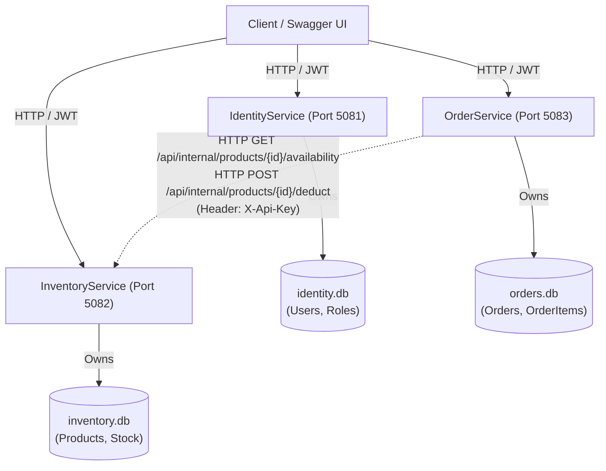

# OrderCore API — Lightweight .NET 9 Microservices Backend

A modular, production-patterned distributed backend core for order and inventory management built with **ASP.NET Core (.NET 9)**, **Entity Framework Core**, **SQLite**, and **JWT Bearer Authentication**.

Designed with architectural clarity, independent service deployability, and local development safety without requiring external database servers.

---

## 1. System Architecture

The ecosystem consists of three decoupled microservices and a lightweight gateway host, each maintaining **strict database ownership** (Database-per-Service pattern). Services never query or mutate each other's databases directly; all cross-service communication occurs via authenticated REST APIs using `IHttpClientFactory`.



### Microservice Roles & Responsibilities

| Service | Port | Database | Primary Responsibility |
| :--- | :--- | :--- | :--- |
| **IdentityService** | `5081` | `identity.db` | User registration, authentication, PBKDF2 password hashing, and signed JWT issuance with role claims (`Admin`, `Customer`). |
| **InventoryService** | `5082` | `inventory.db` | Product catalog CRUD, pagination, stock tracking, and internal availability verification endpoints secured by `X-Api-Key`. |
| **OrderService** | `5083` | `orders.db` | Order placement, server-side authoritative pricing, customer order history, and cancellation. |
| **OrderCore.Gateway** | `5080` | None | Gateway/Host providing system status and service discovery overview. |

---

## 2. Technology Stack & Design Decisions

- **C# / .NET 9 LTS**: Built with the modern .NET 9 SDK.
- **Clean Architecture & Separation of Concerns**: Each microservice follows an intuitive and maintainable folder structure:
  - `Controllers/`: Thin HTTP adapters mapping routes and returning standard HTTP status codes.
  - `Entities/`: Domain models and database schema definitions.
  - `DTO/`: Request/Response data contracts isolating database entities from the API.
  - `Interfaces/`: Abstractions defining service contracts for testability and DI.
  - `Services/`: Core business logic, pricing calculations, and inter-service HTTP integration.
  - `Data/`: EF Core `DbContext` configuration and automatic database seeding.
  - `Common/`: Global exception handling middleware, unified `ApiResponse<T>`, and custom exceptions.
  - `ServiceFilters/`: Action filters such as `ApiKeyAuthAttribute` for inter-service security.
- **Entity Framework Core 9 & SQLite**: Zero-configuration, file-based relational storage. Each service provisions its SQLite database automatically on startup via `EnsureCreatedAsync()`.
- **Stateless JWT Authentication & RBAC**: IdentityService issues cryptographically signed JWT tokens with HMAC-SHA256. InventoryService and OrderService validate tokens locally without blocking network calls back to IdentityService. Supports role-based authorization (`[Authorize(Roles = "Admin")]`).
- **Inter-Service Security**: Internal inventory endpoints (`/api/internal/*`) are protected with an internal API key (`X-Api-Key`) to prevent unauthorized public callers from manipulating stock deductions.
- **Resilient HTTP Communication**: OrderService communicates with InventoryService via typed `HttpClient` with configured timeouts and graceful degradation.
- **xUnit & Moq Test Suite**: 22 unit tests covering business validation, role-based authorization, server-side pricing, and network fault tolerance.

---

## 3. Directory Structure

```text
OrderCore/
├── OrderCore.sln                            # Root solution file
├── OrderManagementSystem/                   # Solution workspace folder
│   ├── OrderCore.Gateway.csproj             # Gateway & Host Project (Port 5080)
│   ├── IdentityService/                     # Identity & JWT Microservice (Port 5081)
│   │   ├── Controllers/                     # AuthController, HealthController
│   │   ├── DTO/                             # RegisterRequest, LoginRequest, AuthResponse, UserDto
│   │   ├── Entities/                        # User, Roles
│   │   ├── Interfaces/                      # IAuthService, IJwtTokenGenerator
│   │   ├── Services/                        # AuthService, JwtTokenGenerator
│   │   ├── Data/                            # IdentityDbContext, IdentityDataSeeder
│   │   ├── Common/                          # ApiResponse, GlobalExceptionMiddleware
│   │   ├── Dockerfile                       # Multi-stage container build
│   │   └── Program.cs
│   ├── InventoryService/                    # Product & Stock Microservice (Port 5082)
│   │   ├── Controllers/                     # ProductsController, InternalProductsController
│   │   ├── DTO/                             # ProductDto, CreateProductRequest, ProductAvailabilityDto
│   │   ├── Entities/                        # Product
│   │   ├── Interfaces/                      # IProductService
│   │   ├── Services/                        # ProductService
│   │   ├── ServiceFilters/                  # ApiKeyAuthAttribute
│   │   ├── Data/                            # InventoryDbContext, InventoryDataSeeder
│   │   ├── Common/                          # ApiResponse, PagedResult, Exceptions
│   │   ├── Dockerfile
│   │   └── Program.cs
│   ├── OrderService/                        # Order Management Microservice (Port 5083)
│   │   ├── Controllers/                     # OrdersController, HealthController
│   │   ├── DTO/                             # CreateOrderRequest, OrderDto, OrderItemDto
│   │   ├── Entities/                        # Order, OrderItem, OrderStatus
│   │   ├── Interfaces/                      # IOrderService, IInventoryClient
│   │   ├── Services/                        # OrderService, InventoryHttpClient
│   │   ├── Data/                            # OrderDbContext
│   │   ├── Common/                          # ApiResponse, PagedResult, Exceptions
│   │   ├── Dockerfile
│   │   └── Program.cs
│   ├── tests/
│   │   ├── IdentityService.Tests/           # xUnit tests for Auth, Roles, and JWT
│   │   ├── InventoryService.Tests/          # xUnit tests for Products & Stock
│   │   └── OrderService.Tests/              # xUnit tests for Orders & Resilient HTTP
│   ├── docker-compose.yml                   # Multi-service container orchestration
│   ├── .dockerignore
│   ├── .gitignore
│   └── README.md
```

---

## 4. Getting Started (Local Development)

### Prerequisites
- [.NET 9 SDK](https://dotnet.microsoft.com/download)
- Visual Studio 2022, JetBrains Rider, or VS Code

### Step 1: Clone and Restore
```powershell
git clone https://github.com/PravinKharat26/OrderCore-API.git
cd OrderCore-API
dotnet restore OrderCore.sln
```

### Step 2: Run Unit Tests
Verify all 22 tests pass:
```powershell
dotnet test OrderCore.sln
```

### Step 3: Run the Microservices
In Visual Studio, configure Multiple Startup Projects:
- `IdentityService`
- `InventoryService`
- `OrderService`

Or run via CLI in separate terminal windows:

**Terminal 1 — IdentityService:**
```powershell
cd OrderManagementSystem/IdentityService
dotnet run --launch-profile http
```
*API running at: `http://localhost:5081/swagger`*

**Terminal 2 — InventoryService:**
```powershell
cd OrderManagementSystem/InventoryService
dotnet run --launch-profile http
```
*API running at: `http://localhost:5082/swagger`*

**Terminal 3 — OrderService:**
```powershell
cd OrderManagementSystem/OrderService
dotnet run --launch-profile http
```
*API running at: `http://localhost:5083/swagger`*

---

## 5. Pre-Seeded Accounts & Product Catalog

### Seeded Users
On startup, `IdentityService` automatically provisions:

| Role | Email | Password | Permissions |
| :--- | :--- | :--- | :--- |
| **Admin** | `admin@ordermanagement.local` | `Admin@12345!` | Product catalog creation/editing, viewing all orders |
| **Customer** | `customer@ordermanagement.local` | `Customer@12345!` | Placing orders, viewing/cancelling own orders |

### Seeded Products in InventoryService
1. **ThinkPad X1 Carbon Gen 11** — Price: `$1499.99`, Stock: `25`
2. **Logitech MX Master 3S** — Price: `$99.99`, Stock: `100`
3. **Keychron Q1 Pro Mechanical Keyboard** — Price: `$199.50`, Stock: `50`
4. **Dell UltraSharp 27 4K USB-C Hub Monitor** — Price: `$549.00`, Stock: `15`
5. **Sony WH-1000XM5 Wireless Headphones** — Price: `$398.00`, Stock: `40`

---

## 6. End-to-End Walkthrough via Swagger or cURL

### 1. Authenticate (Obtain JWT)
Send a login request to `POST http://localhost:5081/api/auth/login`:
```json
{
  "email": "customer@ordermanagement.local",
  "password": "Customer@12345!"
}
```
**Response:**
```json
{
  "success": true,
  "message": "Login successful.",
  "data": {
    "token": "eyJhbGciOiJIUzI1NiIsInR5cCI6IkpXVCJ9...",
    "expiresAtUtc": "2026-10-28T16:50:00Z",
    "user": {
      "id": "e6741df7-8730-4e89-8d76-880cbfb9b5f9",
      "username": "johndoe",
      "email": "customer@ordermanagement.local",
      "role": "Customer"
    }
  }
}
```

### 2. Use JWT in Swagger UI
1. Copy the `token` string from the response.
2. Open Swagger UI at `http://localhost:5082/swagger` or `http://localhost:5083/swagger`.
3. Click the **Authorize** button at the top right.
4. Enter: `Bearer <your_token>` and click **Authorize**.

### 3. Check Inventory Catalog
`GET http://localhost:5082/api/products?page=1&pageSize=5`

### 4. Place an Order (OrderService)
`POST http://localhost:5083/api/orders`
```json
{
  "items": [
    {
      "productId": 2,
      "quantity": 2
    },
    {
      "productId": 3,
      "quantity": 1
    }
  ]
}
```
> [!IMPORTANT]
> The client does **NOT** provide product prices or customer IDs!
> - The **Customer ID** is extracted server-side from the validated JWT token (`sub` claim).
> - The **Product Prices** are queried in real time from `InventoryService` via internal API key (`X-Api-Key`) to prevent client-side price tampering.
> - `TotalAmount` is calculated server-side: `(2 * 99.99) + (1 * 199.50) = 399.48`.

### 5. Check Customer Orders
`GET http://localhost:5083/api/orders`
Customers will only see orders matching their authenticated `sub` ID. Admins can view orders across all customers.

---

## 7. Distributed Consistency & Architecture Notes

In this lightweight core, inter-service coordination uses synchronous HTTP:
1. `OrderService` queries `InventoryService` for stock availability and current pricing.
2. `OrderService` sends a stock deduction request to `InventoryService` authenticated via `X-Api-Key`.
3. `OrderService` persists the order to `orders.db`.

### Scalability Progression (Event-Driven Architecture)
For higher throughput or async decoupling, this architecture easily extends to:
- **Outbox Pattern**: `OrderService` saves the order and an outbox event in the same local database transaction.
- **Message Broker (RabbitMQ / Kafka)**: Publishes `OrderPlacedEvent`.
- **Saga Pattern**: `InventoryService` consumes `OrderPlacedEvent` and reserves stock asynchronously.

---

## 8. Docker Deployment

To run all services inside containers:
```powershell
docker-compose up --build
```
This builds and orchestrates all services on `ordercore-network` with persistent named volumes (`identity-data`, `inventory-data`, `order-data`).
